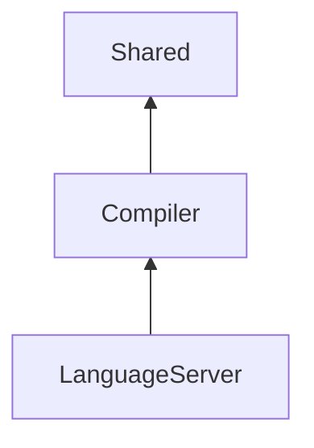

AGENTS.md
=========

## 目的

Native Instruments KONTAKT が提供するスクリプト言語 KSP (Kontakt Script Processor) のコンパイラ・言語サーバー を開発するためプロジェクト。

[VS Code 拡張機能側](https://github.com/r-koubou/vscode-ksp)でビルドした言語サーバーを利用している。

## KSPとは

https://docs.native-instruments.com/online-guides/ksp-manual/en/welcome-to-ksp

## Dewpwiki

Dewpwiki 上の KSPCompiler に関するページへのリンク

https://deepwiki.com/r-koubou/KSPCompiler

## 主となるアプリケーション

- Compiler : KSP のコンパイルを行うアプリケーション
    - 現状は単体で利用されることは少なく、主に言語サーバーから利用される。

-言語サーバー: KSP の言語サーバーを提供するアプリケーション
    - VS Code 拡張機能側で利用される。

## ディレクトリ構成

本プロジェクトのプログラムコードは Compiler ディレクトリに配備され、その他のディレクトリは、コンパイラの実行に必要なデータやツールを配備する。

```
├── .github             GitHub Actions のワークフローや設定ファイルを配備
├── Compiler            コンパイラ・言語サーバーの C# ソリューション
├── Data                コンパイラが起動時に読み込むビルトインのシンボルデータを配備
├── Grammar             KSP の文法定義を配備 (ANTLRを使用)
└── Tools               小規模なメンテナンスツール各種
```

Tools以下の雑多なツール類は skills として整理可能な内容なため、将来的には Tools ディレクトリを skills ごとに分割することも検討される。

## アーキテクチャ

`Clean Architecture` をベースにした、Vertical Slice で構成されている。
スライスは関心事ごとに分離され、他のスライスからの依存関係は一方向である。

### スライスの単位と関係性

| 項目                    | 説明                                                                               |
| ----------------------- | ---------------------------------------------------------------------------------- |
| Shared                  | コアドメインモデルモデル、他スライスから参照される共通のユーティリティやライブラリ |
| Features/Compiler       | コンパイラのスライス                                                               |
| Features/LanguageServer | 言語サーバーのスライス                                                             |




### コアドメイン

このプロジェクトにおけるコアドメインは以下から構成される。

| 項目   | 説明                                                               |
| ------ | ------------------------------------------------------------------ |
| AST    | 抽象構文木。KSP の構文要素を階層的に表現す。                       |
| Symbol | KSP のシンボル。変数や関数などの名前付き要素を表現するデータ構造。 |

## ANTLRによる文法定義

本プロジェクトでは、KSP の文法定義に ANTLR を使用している。

`/Grammar` ディレクトリに ANTLR の文法定義ファイルを配置。

ANTLRを用いた具体的な実装は、Compilationスライス内の Infrastructure 層で行われる。

現在は未対応だが、 [SublimeKSP](https://github.com/nojanath/SublimeKSP) の拡張構文への対応も検討しているが、現時点では未対応で優先度は低いが g4 ファイルで対応の余地は残している。

## ビルトインのシンボル定義

本プロジェクトでは、KSP のビルトインシンボルを定義するデータを `/Data` ディレクトリに配置している。
コンパイラは起動時にこれを読み込み、シンボル解決に利用する。

Shared.IO.Symbols.Yaml にて、`/Data` ディレクトリに配置されたビルトインシンボルの YAML ファイルを読み込み、ドメインモデル Symbol に変換する。

## コンパイラ

厳密には実行コードの生成は行わず、「字句解析、構文解析、KSPで定義されているプリプロセス、意味解析フェーズ」までを担当する。

オプショナルで指定がある場合は意味解析フェーズの後にオブファスケーションを行う。

### UseCase

#### UseCase/Analysis.Abstractions

`UseCase/Analysis.Abstractions` では、スクリプトの解析に関する抽象的なインターフェースを定義する。具体的な解析処理は、このインターフェースを実装する形で提供される。

UseCase以外についても現状はSOLID原則を強く意識し、スクリプトの評価単位でインタフェースを定義している。

### UseCase/Analysis

`UseCase/Analysis` では、スクリプトの解析に関する具体的な処理を実装する。抽象化されたインターフェースに従い、構文解析、意味解析などの処理を行う。

### ApplicationServices

`ApplicationServices``層では、UseCase`層で実装されたユースケースを呼び出すためのオーケストレーションを担当する。複数のユースケースを組み合わせて、アプリケーション全体のフローを制御する役割を持つ。

## 言語サーバー

各種LSPの機能を実装し、VS Code 拡張機能からのリクエストに応答する。

UseCase 層は、LSP の各種リクエストに相当するアプリケーションロジックを実装している。特定の言語サーバーのフレームワークに依存せず、汎用的に利用可能な形で設計されている。

Application 層は、UseCase 層を呼び出し、LSP のフレームワークに依存した形でリクエストの受信やレスポンスの送信を行う。

また、必要に応じてコンパイラの機能を呼び出し、スクリプトの評価やエラー情報の取得を行う。

## ビルトインのシンボル定義ファイル(YAML)

`/Data/Symbols` ディレクトリに配置された YAML ファイルと共にスキーマファイルも同梱されている。(`*-schema.yaml`)
